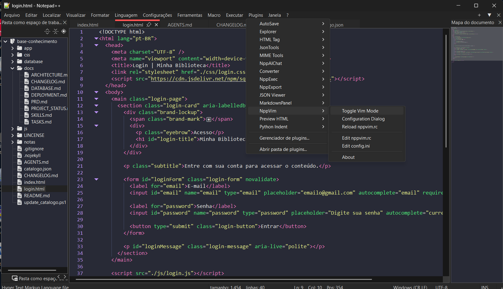

# NppVim para Notepad++

Este repositório reúne arquivos relacionados ao **NppVim**, um plugin que adiciona edição modal e atalhos inspirados no Vim ao Notepad++. Com ele, você pode navegar e editar usando modos e comandos familiares do Vim diretamente no editor.

> Este repositório é uma cópia de apoio e pode não conter a versão mais recente. Para obter a versão atual, consultar a documentação e verificar compatibilidade, acesse o projeto original indicado no final desta página.

## Captura de tela



## Instalação rápida

1. Feche completamente o Notepad++.
2. Baixe uma versão do NppVim compatível com a arquitetura do seu Notepad++ (32 ou 64 bits) na página de releases do projeto original.
3. Extraia os arquivos e copie a pasta `NppVim` para a pasta `plugins` do Notepad++. A estrutura deve ficar assim:
   ```text
   <pasta do Notepad++>\plugins\NppVim\NppVim.dll
   ```
   Se a pasta `NppVim` já existir, faça uma cópia de segurança antes de substituir os arquivos.
4. Abra novamente o Notepad++. O plugin deverá aparecer no menu **Plugins**.

> Não sabe onde o Notepad++ está instalado? No Notepad++, use **Configurações > Preferências > Pastas** para conferir os caminhos disponíveis. A instalação precisa corresponder à arquitetura do aplicativo.

## Primeiros passos

- Pressione `i` para entrar no modo de inserção.
- Pressione `Esc` para voltar ao modo normal.
- Pressione `:` para acessar o modo de comandos.
- Use `:help` ou `:h` para consultar a ajuda do plugin.

O NppVim oferece comandos e atalhos para navegação, seleção, busca, edição, macros e comandos como `:w` e `:wq`. Os recursos e as configurações podem variar conforme a versão instalada; consulte a documentação do projeto original para obter os detalhes completos.

## Configuração

A documentação do NppVim descreve os arquivos de configuração `nppvim.rc` e `config.ini`, incluindo caminhos padrão, opções e mapeamentos personalizados. Consulte a documentação da versão instalada antes de editar esses arquivos.

## Projeto original

Acesse o repositório original do NppVim para obter downloads, documentação, novidades e suporte:

**[NppVim — projeto original no GitHub](https://github.com/h-jangra/NppVim)**
